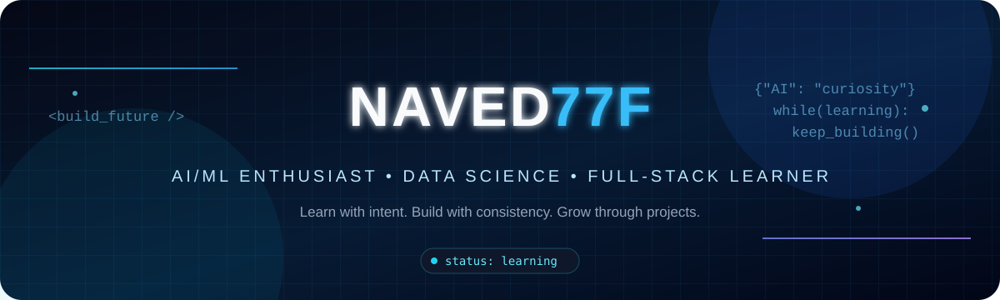

  <picture>
    <source media="(prefers-color-scheme: dark)" srcset="dark.svg">
    <source media="(prefers-color-scheme: light)" srcset="light.svg">
    
  </picture>

<h1 align="center">Hi, I'm Naved 👋</h1>
<h3 align="center">AI/ML Enthusiast · Data Science Learner · Full-Stack Explorer</h3>

  
  
  

---

## 👨‍💻 About Me

- 🎓 B.Com graduate, now expanding into technology and software development.
- 🤖 Interested in **Artificial Intelligence, Machine Learning, and Data Science**.
- 🐍 Learning and practicing Python, data analysis, SQL, and machine-learning workflows.
- 🧩 Exploring full-stack development alongside my MCA learning journey.
- 🛠️ I learn best by building projects, improving them, and sharing my work.
- 🌱 Current focus: strengthen fundamentals, practice consistently, and build useful projects.

> **My approach:** Learn with intent. Build with consistency. Grow through projects.

## 🧰 Tech Stack & Tools

  

  
  
  
  
  

## 🚀 Featured Projects

### 1. QuantFormer — Multimodal Order-Book & Sentiment Research
A collaborative project exploring order-book data and financial sentiment with deep-learning components.

- **Focus:** Python, PyTorch, FastAPI, transformer-based modeling
- **Repository:** [View QuantFormer](https://github.com/Devansh1-tech/QuantFormer-Multimodal-Order-Book-Sentiment-Transformer)

### 2. EconoCausal — Dynamic Pricing with Causal Inference
A learning project exploring dynamic pricing and causal-inference methods, including Double Machine Learning.

- **Focus:** Python, Jupyter Notebook, machine learning, causal inference
- **Repository:** Add the repository URL here when ready.

### 3. More projects coming
I’m working on strengthening my fundamentals and turning practice notebooks into clear, documented projects.

> Tip: Replace the EconoCausal placeholder above with the exact repository URL before publishing, if that repository is public.

## 📊 GitHub Overview

  
  

  

## 🐍 Contribution Snake

  <picture>
    <source media="(prefers-color-scheme: dark)" srcset="https://raw.githubusercontent.com/naved77f/github-snake/output/github-snake-dark.svg">
    <source media="(prefers-color-scheme: light)" srcset="https://raw.githubusercontent.com/naved77f/github-snake/output/github-snake.svg">
    
  </picture>

## 🎯 What I'm Working Toward

- Building stronger Python and SQL fundamentals.
- Practicing data structures, algorithms, and problem-solving.
- Learning machine learning through hands-on experiments.
- Improving software-development skills through my MCA journey.
- Publishing projects with better documentation and reproducible steps.

## 🤝 Connect With Me

- **LinkedIn:** [Naved Hasan](https://www.linkedin.com/in/naved-hasan-4a7a1a3a1/)
- **Email:** [kaif95277@gmail.com](mailto:kaif95277@gmail.com)
- **GitHub:** [@naved77f](https://github.com/naved77f)

  <i>Thanks for visiting — keep learning, keep building 🚀</i>

